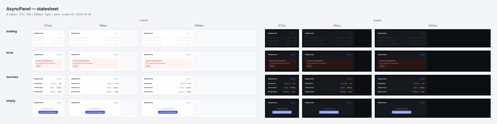
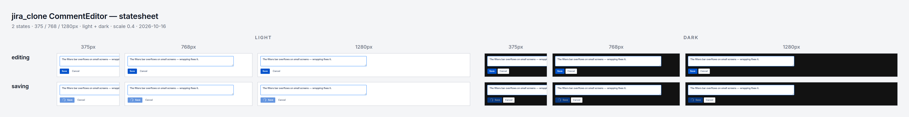
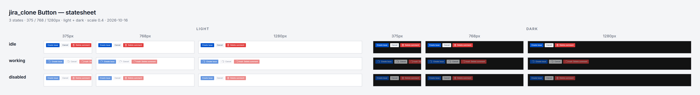

# Statesheet

One contact sheet for every state of a React component — state ×
viewport (375 / 768 / 1280) × light/dark, mounted directly with
Playwright and esbuild, **no Storybook required** — plus a scanner for
boolean state piles (`isLoading && !error && …`) and a generated
reducer whose transitions live in one explicit table.



The bundled [`fixtures/async-panel.tsx`](fixtures/async-panel.tsx)
rendered by `sheet` — 4 states × 3 viewports × 2 themes, one labeled
grid, verified pixel-exact before the file is written.

## Quick start

```bash
cd skills/statesheet && npm install   # one-time: esbuild + playwright-core (drives system Chrome)

# 1. find boolean piles
node scripts/statesheet.mjs scan path/to/app/src

# 2. propose a reducer + transition table for one of them
node scripts/statesheet.mjs propose path/to/Component.jsx --component Component

# 3. declare states next to the component, then photograph them
node scripts/statesheet.mjs sheet path/to/component.states.tsx
```

Node ≥ 20 and an installed Chrome/Chromium (`STATESHEET_BROWSER=<path>`
to override). The target app's own `node_modules` must be installed:
the component is bundled from its directory, so `react`, `react-dom`
(17-era `ReactDOM.render` and 18+ `createRoot` both work), CSS/CSS
modules, images, and fonts resolve from the app, not from this skill.

## The states file

A small module next to the component that says what to mount and which
states to force. Each state is either a props object or a zero-arg
render function (for variants, wrappers, or clusters):

```tsx
import { Panel } from "./panel";

export default {
  name: "Panel",                 // sheet title (default: component name)
  component: Panel,
  states: {
    loading: { isLoading: true },
    error: { error: "GET /api returned 503" },
    success: { data: rows },
    detail: () => <Panel data={rows} expanded />,   // render function form
  },
  wrap: (el, { theme }) => <ThemeProvider mode={theme}>{el}</ThemeProvider>, // optional
  background: { light: "#f8f9fb", dark: "#0c0e12" },   // optional page bg per theme
  darkClass: "dark",             // class set on <html> for dark (default "dark")
  padding: 16,                   // px around the component in each cell
};
```

Dark cells get Chrome's `prefers-color-scheme: dark`, the `darkClass`
on `<html>`, and `data-theme="dark"` — covering the three common
theming conventions. Animations and transitions are frozen for
deterministic frames.

## Commands and options

```bash
statesheet.mjs sheet <states-file>
  --out <file.png>     default <name>-statesheet.png
  --viewports <list>   default 375,768,1280
  --themes <list>      default light,dark
  --states <list>      subset of declared states
  --scale <n>          capture display scale (default 0.5; captures are @2x)
  --max-height <px>    max capture height per cell (default 800)
  --wait <ms>          settle time after render (default 200)
  --alias <k=v>        bundler alias, repeatable (webpack/tsconfig aliases)
  --node-paths <list>  extra module roots relative to the states file
                       (apps that import from a src root, e.g. `shared/…`)

statesheet.mjs scan <dir|file> [--min <n>] [--json]
statesheet.mjs propose <file> [--component <Name>] [--write]
```

Exit codes: `0` ok, `1` a verification check failed (no PNG written),
`2` usage or runtime error.

## Built-in verification (every sheet, exit 1 on failure)

The grid is computed in integer CSS pixels and rendered with absolutely
positioned cells, so the tool knows where every pixel must land and
checks the output PNG against it:

- sheet dimensions match the computed layout exactly (@2x);
- every cell border sits at its computed position;
- gutters between label column, grid columns, and rows are clean
  sheet background — even spacing is asserted, not eyeballed.

A failed check prints `check: … FAIL` and writes nothing.

## The reducer proposal

`scan` finds components where ≥2 boolean useStates ride together, and
`propose` replaces the pile with a machine. The key property: **the
reducer consults only the `transitions` table**. A transition that is
not a row in the table throws in dev and is a no-op in prod — so an
agent (or a hurried human) cannot add a transition anywhere except the
table itself, where review will see it:

```ts
export const transitions = {
  idle:    { START: "loading" },
  loading: { RESOLVE: "success", REJECT: "error" },
  success: { START: "loading", RESET: "idle" },
  error:   { START: "loading", RESET: "idle" },
} as const satisfies Record<Status, Partial<Record<Event["type"], Status>>>;
```

Async-looking booleans (`isSaving`, `isUpdating`, `isCreating`, …)
become the lifecycle; orthogonal toggles (`showTooltip`, `isFormOpen`)
are reported as flags and kept out of the machine. Piles with no
lifecycle get a scaffold with TODO edges. The generated file passes
`tsc --strict` standalone, and includes a wire-up sketch plus a
matching states-file stub.

## Tested on a real app: oldboyxx/jira_clone (2026-10-16)

[jira_clone](https://github.com/oldboyxx/jira_clone) — React 16 +
styled-components, absolute imports from the `src` root (handled with
`--node-paths .`), real `@font-face` fonts.

`scan client/src` → 134 files, 2 piles, both real:

```
Project/Board/IssueDetails/Comments/Comment/index.jsx:26 ProjectBoardIssueDetailsComment
  — 2 boolean useStates: isFormOpen, isUpdating → 4 combos
Project/Board/IssueDetails/Comments/Create/index.jsx:17 ProjectBoardIssueDetailsCommentsCreate
  — 2 boolean useStates: isFormOpen, isCreating → 4 combos
```

(`Comment` even has the classic pile bug: a failed update leaves
`isUpdating` stuck on `true` — its `catch` never resets it.) `propose`
models `isUpdating` as the idle/loading/success/error lifecycle and
keeps `isFormOpen` out as a flag.

`sheet` on the comment editor (the surface behind that pile) and on the
shared `Button` (`isWorking` / `disabled`), with its render-function
states showing three variants per state:





jira_clone has no dark theme of its own, so its dark cells show the
real behavior honestly: the page canvas goes dark, the components keep
their light styling. The fixture sheet above shows a component with
true dark styling.

## Known limitations

- `scan`/`propose` are a lexical pass, not a typechecker: unusual
  declaration shapes (components built by HOC factories, state in
  render props) can be missed, and bucket classification is by name.
  Treat hits as leads; the diff is yours to review.
- The sheet forces states **from outside** (props / render functions /
  wrappers). Internal `useState` booleans cannot be forced without a
  refactor — that is the finding `propose` exists for.
- Build-time CSS pipelines (Tailwind JIT, Sass) are not run; esbuild
  bundles plain CSS, CSS modules, and CSS-in-JS. For Tailwind apps,
  point a `wrap` or imported stylesheet at the app's built CSS.
- Components that fetch on mount render whatever their effects settle
  to; mock at the states file level (`wrap`, stub props) for
  deterministic cells.

## Tests

```bash
npm test                                # node --test, no browser needed for unit tests
STATESHEET_REQUIRE_BROWSER=1 npm test   # CI mode: integration tests must run
```

16 tests: scanner attribution, bucket classification, proposal shape
(table-driven reducer, flags kept out, scaffold path), exact grid
geometry, PNG round-trip, CLI validation, and two end-to-end sheet runs
against the fixture (checks must pass; a bad state must fail loudly).
