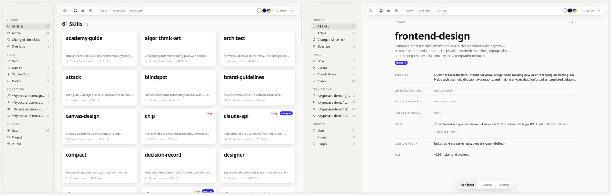
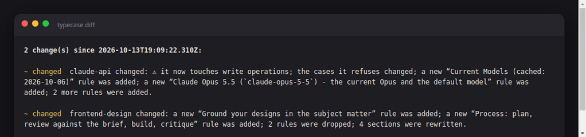
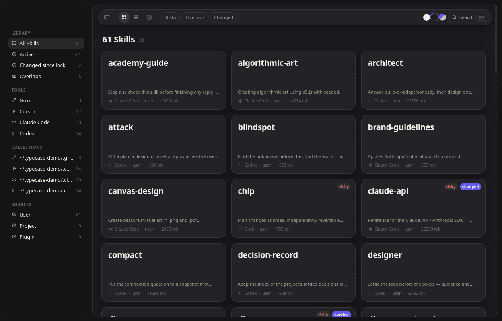
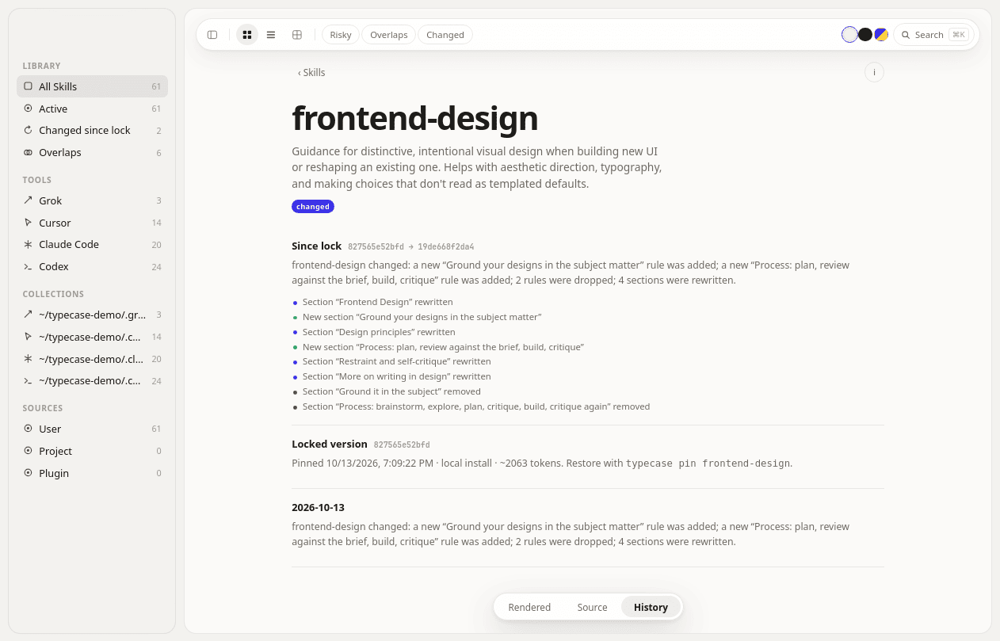
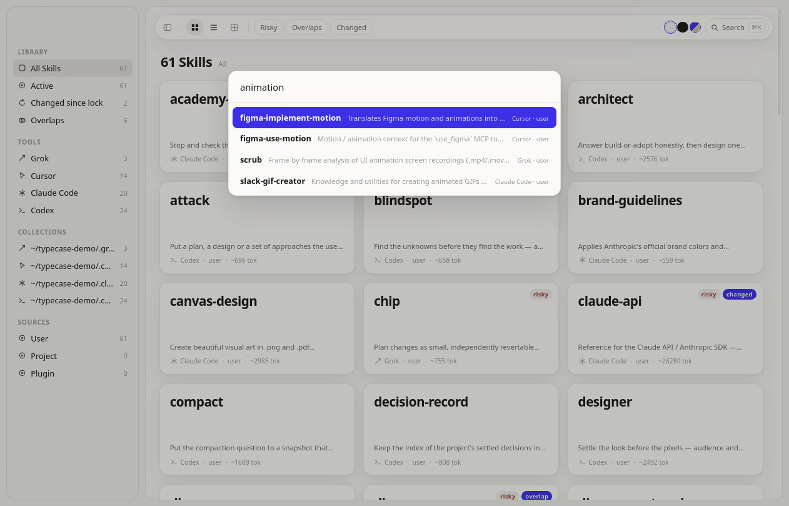
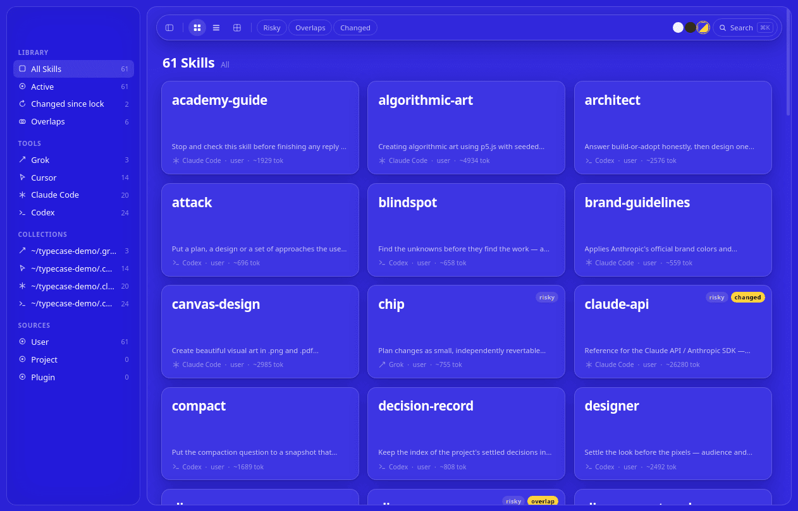

# Typecase

The case your agent skills live in. Typecase finds every skill installed
for Grok, Cursor, Claude Code, and Codex, parses each `SKILL.md` into a
structured record, and gives you three layers on top:

1. **A parser library** (`scripts/lib/`) — discovery, parsing, duplicate
   and overlap detection. Importable; everything else is built on it.
2. **A reader** — `ls`, `where`, `show` in the terminal, plus a Mac-first
   Electron app (`open`).
3. **A lockfile and changelog** — `lock`, `diff`, `pin`, and a running
   `TYPECASE.md` with one plain-language paragraph per skill change.



*All screenshots show public open-source skill packs only (Anthropic's
[skills](https://github.com/anthropics/skills), Figma's
[mcp-server-guide](https://github.com/figma/mcp-server-guide),
[donald-ada/workinggenius](https://github.com/donald-ada/workinggenius),
and this repo) — nothing private or internal.*

## Quick start

```bash
node skills/typecase/scripts/typecase.mjs ls                     # everything installed
node skills/typecase/scripts/typecase.mjs where "crop a video"   # which skill handles this?
node skills/typecase/scripts/typecase.mjs show chip              # read one skill
node skills/typecase/scripts/typecase.mjs lock                   # pin current state
node skills/typecase/scripts/typecase.mjs diff                   # what changed since lock (exit 1 if anything)
node skills/typecase/scripts/typecase.mjs pin chip               # restore a skill from its snapshot
node skills/typecase/scripts/typecase.mjs open                   # desktop reader
```

The CLI has zero dependencies (Node ≥ 18). The desktop app is a separate
optional package under [`app/`](app/) — Electron is **not** a dependency
of the CLI.


## Where it looks

Every path is sourced; the same table lives as a comment in
[`scripts/lib/paths.mjs`](scripts/lib/paths.mjs).

| Tool | Project | User | Plugin / other | Source |
| --- | --- | --- | --- | --- |
| Grok | `.grok/skills` (walked up to the repo root) | `$GROK_HOME/skills`, default `~/.grok/skills` | `./.grok/plugins` and `~/.grok/plugins` (each plugin's `skills/`), marketplace installs under `~/.grok/plugins/marketplaces/` | [docs.x.ai](https://docs.x.ai/build/features/skills-plugins-marketplaces) |
| Cursor | `.cursor/skills`, `.agents/skills` (nested dirs too) | `~/.cursor/skills`, `~/.agents/skills` | `~/.cursor/plugins/cache/<marketplace>/<id>/<rev>/skills/` (observed layout, not documented — may change) | [cursor.com/docs/skills](https://cursor.com/docs/skills) |
| Claude Code | `.claude/skills` (this dir and parents) | `~/.claude/skills` | plugins ship `skills/` folders under `~/.claude/plugins/` | [code.claude.com](https://code.claude.com/docs/en/skills) |
| Codex | `.agents/skills` (cwd up to repo root) | `~/.codex/skills` (`$CODEX_HOME`, scanned recursively per docs), `~/.agents/skills` | admin `/etc/codex/skills` | [developers.openai.com](https://developers.openai.com/codex/skills) |

`.agents/skills` dirs are read by Grok, Cursor, and Codex alike, so
Typecase reports them once under the pseudo-tool `shared` instead of
triple-counting one install.

Extra locations: drop a `typecase.json` in the working directory or
`~/.config/typecase/`:

```json
{ "paths": [{ "dir": "/opt/team-skills", "tool": "shared", "scope": "user" }] }
```

## What the parser extracts

`parseSkill` returns one record per skill: frontmatter (`name`,
`description`, the rest verbatim), tool, scope (user / project / plugin /
admin), paths, every section with a token estimate, trigger text,
"when not to use" text, referenced files that resolve inside the skill
folder, commands mentioned in code spans, risky tool mentions (network,
write, exec, sudo), total token size, and a content hash over the whole
skill folder. Malformed skills become parse-error records instead of
crashing the run.

On top of the records, discovery flags **duplicates** (same name
installed for more than one tool — marked identical when the content
hashes match) and **overlaps** (pairs whose trigger vocabulary passes a
Jaccard similarity threshold of 0.35 — skills that will race for the
same requests).

```js
import { discover, where } from "./scripts/lib/discover.mjs";
const data = discover();            // { roots, skills, duplicates, overlaps }
const hits = where(data, "resize a video");
```

`ls --json` and `diff --json` emit the same structures for scripting.

## Lock, diff, pin

`lock` writes `skills.lock`: per skill, the content hash, token size, and
the best source identity it can find — the git remote + commit if the
skill folder lives in a repo, a plugin/package version from a nearby
manifest, or `local`. It also snapshots each skill folder by hash under
`~/.cache/typecase/snapshots/` so `pin <skill>` can restore the locked
version later (the current version is backed up first).

`diff` re-discovers everything and compares against the lock **section by
section** — added/removed/rewritten sections, trigger changes, "when not
to use" changes, command and risky-tool deltas — then compresses each
skill's changes into one plain-language paragraph about what the agent
will now do differently. Real output from bumping Anthropic's
[skills](https://github.com/anthropics/skills) pack from `5304866` to
`dbd4588`:



> **frontend-design** changed: a new "Ground your designs in the subject
> matter" rule was added; a new "Process: plan, review against the brief,
> build, critique" rule was added; 2 rules were dropped; 4 sections were
> rewritten.

Paragraphs are deterministic by default. Set `TYPECASE_LLM_CMD` to any
shell command to route the change JSON (stdin) through an LLM instead;
on any failure it falls back to the deterministic text.
`diff --write-changelog` appends dated entries to `TYPECASE.md`, and
`lock` does the same automatically when it replaces an older lock.

## The desktop app

`typecase open` launches a Mac-first Electron reader (translucent sidebar
vibrancy, system font, light/dark/accent themes, full keyboard
navigation, ⌘K search). It imports the same parser library as the CLI —
no duplicated parsing logic — and live-reloads when any skill folder
changes on disk.



- **Sidebar** — Library (All, Active, Changed since lock, Overlaps),
  Tools, Collections (one per skill root), Sources (user / project /
  plugin scope).
- **Specimen grid** — each card leads with the skill name, one-line
  description, and tool · scope · token size, with duplicate / overlap /
  risky / changed badges. Grid or list, two densities.
- **Detail view** — hairline rows for triggers, when (not) to use, tools
  it can call with risky flags, files referenced, path (Reveal in
  Finder / Open in Cursor), overlaps, and lock state; an info button
  shows raw frontmatter. A floating segmented control switches
  **Rendered / Source / History** — History shows the locked version,
  the since-lock paragraph with a section-level diff, and this skill's
  `TYPECASE.md` entries.





Run it in development:

```bash
cd skills/typecase/app
npm install
npm start                 # or: node ../scripts/typecase.mjs open
```

Package an unsigned local Mac `.app` (no notarization; for your own
machine):

```bash
cd skills/typecase/app
npm run dist              # electron-builder --mac --dir → dist/mac*/Typecase.app
```

If the app dependencies aren't installed, `typecase open` falls back to
writing a small self-contained HTML reader to a temp file and opening it
in your browser — kept deliberately tiny (search, filters, detail,
History) so `open` still does something useful on a headless box or
fresh machine.

## Testing

```bash
node --test skills/typecase/scripts/typecase.test.mjs   # parser + CLI (12 tests)
cd skills/typecase/app && npm install && npx playwright test   # Electron smoke (4 tests)
```

CI runs both; the Electron suite runs under `xvfb-run` on Linux runners.

## Tested on (real packs)

| Pack | Commit | Result |
| --- | --- | --- |
| [anthropics/skills](https://github.com/anthropics/skills) | `5304866` → `dbd4588` | 20 skills parsed; lock → version bump → `diff` produced the paragraphs above; `pin` restored the locked `frontend-design` |
| [figma/mcp-server-guide](https://github.com/figma/mcp-server-guide) | `b0bfad2` | 14 skills; `figma-generative-plugins` ↔ `figma-shaders` flagged as overlapping (0.52 shared trigger vocabulary) |
| [donald-ada/workinggenius](https://github.com/donald-ada/workinggenius) | `3823c44` | 24 skills incl. an `errata` skill (which is why this tool isn't called Errata); 3 overlap pairs flagged |
| [clodoan/skills](https://github.com/clodoan/skills) (this repo) | — | chip, scrub, plinth, ramble; `where "animation timing easing jank"` → scrub (score 0.54) |

Side by side that's 61 skills across four tools, with one planted
cross-tool duplicate (`figma-design-to-code` installed for both Claude
Code and Cursor) detected as identical copies. `poteto/pstack` was
requested as a test pack but isn't publicly available, so the public
packs above stand in for it.

## Notes

- Name check: "errata" collides with an existing agent skill
  (donald-ada/workinggenius) and an npm CLI; "typecase" — a printer's
  type drawer — had no agent-skill, CLI, or Figma-plugin collisions at
  the time of writing.
- `skills.lock` and `TYPECASE.md` are per-directory, so a repo can pin
  its project skills independently of your user-level installs.
